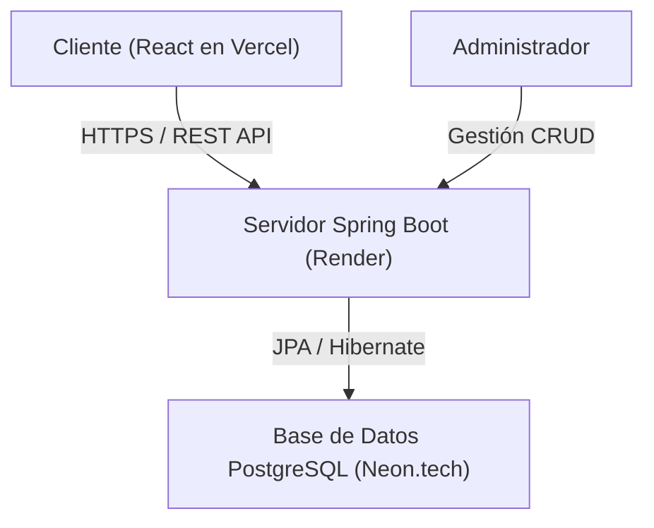
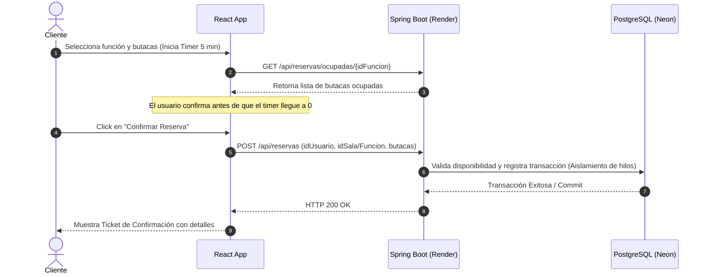

# 🎬 Sistema de Reservas de Cine (Full-Stack)

Plataforma web full-stack desarrollada para la gestión integral de reservas de cine en tiempo real. El sistema implementa control de aforo dinámico, arquitectura orientada a objetos, control de concurrencia, gestión estricta de sesiones y tiempos de expiración.

---

## 🚀 Stack Tecnológico

* **Backend:** Java, Spring Boot, Spring Security, Hibernate / JPA, Maven.
* **Frontend:** React, Vite, CSS (Modo Oscuro Cinematográfico).
* **Base de Datos:** PostgreSQL (alojada en Neon.tech).
* **Infraestructura & Despliegue:** Docker, Render (Backend), Vercel (Frontend).

---

## 🔑 Credenciales de Acceso por Rol (Demo)

Para probar las distintas vistas de la aplicación al iniciar sesión:

* **Administrador (Gestión de cines, salas, películas y funciones):**
  * **Email:** `admin@reservas.com`
  * **Contraseña:** Configurada en la base de datos (Rol: `ADMIN`)

* **Cliente (Exploración de cartelera y reserva de butacas):**
  * **Email:** `cliente@reservas.com` (o cualquier usuario registrado con rol de cliente)
  * **Contraseña:** Configurada en la base de datos (Rol: `CLIENTE`)

---

## 🧠 Lógica de Negocio y Arquitectura del Sistema

### 1. Control de Aforo y Lógica de Reservas
* **Capacidad Dinámica por Sala:** Cada sala posee una capacidad configurable (ej. 50 butacas), la cual determina de forma dinámica la cantidad de asientos renderizados en la grilla interactiva del cliente.
* **Prevención de Doble Reserva:** Antes de consolidar el registro, el backend valida el estado actual de los asientos ocupados en la función seleccionada, evitando colisiones de aforo.
* **Temporizador de Sesión de Compra (5 Minutos):** Al iniciar la selección de butacas, el sistema activa un contador estricto de 300 segundos en el frontend. Si el usuario no confirma la transacción a tiempo, las butacas se liberan automáticamente para evitar el bloqueo prolongado de inventario (*inventory starvation*).

### 2. Gestión de Concurrencia y Prevención de Deadlocks
En escenarios de alta concurrencia donde múltiples usuarios intentan reservar asientos adyacentes o simultáneos, pueden producirse condiciones de carrera e interbloqueos (**deadlocks**). Para garantizar la integridad transaccional:
* **Transacciones Aisladas y Bloqueos:** Las operaciones de persistencia operan bajo transacciones acotadas (`@Transactional`) que aíslan las lecturas y escrituras sobre los registros de asientos y funciones.
* **Ordenamiento de Recursos:** La lógica de procesamiento en el servidor adquiere y bloquea los identificadores de butacas en orden ascendente estricto, previniendo ciclos de espera circular (*circular wait*) entre los hilos concurrentes del backend.

---

## 📊 Diagramas del Sistema

### Diagrama de Arquitectura General


### Diagrama de Secuencia: Flujo de Reserva y Control de Tiempo


---

## ⚙️ Documentación de Endpoints de la API

### 🔐 Autenticación

* **`POST /api/auth/login`**
* *Descripción:* Valida las credenciales del usuario y retorna los datos de sesión (incluyendo su rol: `ADMIN` o `CLIENTE`).
* *Body (JSON):* `{ "email": "...", "password": "..." }`

### 📍 Cines y Salas

* **`GET /api/cines`**
* *Descripción:* Retorna el listado completo de cines registrados junto con sus ubicaciones y salas asociadas.

* **`POST /api/cines`** *(Admin)*
* *Descripción:* Registra un nuevo complejo de cine.

* **`DELETE /api/cines/{id}`** *(Admin)*
* *Descripción:* Elimina un cine y sus dependencias en cascada.

* **`POST /api/salas/cine/{idCine}`** *(Admin)*
* *Descripción:* Agrega una nueva sala con capacidad personalizada a un cine específico.

* **`PUT /api/salas/{idSala}`** *(Admin)*
* *Descripción:* Modifica la capacidad de asientos de una sala existente.

* **`DELETE /api/salas/{idSala}`** *(Admin)*
* *Descripción:* Elimina una sala del sistema.

### 🎬 Películas y Catálogo

* **`GET /api/peliculas`**
* *Descripción:* Obtiene el catálogo completo de películas disponibles.

* **`POST /api/peliculas`** *(Admin)*
* *Descripción:* Da de alta una nueva película en el sistema.

* **`DELETE /api/peliculas/{id}`** *(Admin)*
* *Descripción:* Elimina una película del catálogo general.

### 🕒 Funciones y Cartelera

* **`GET /api/funciones`**
* *Descripción:* Retorna todas las funciones programadas en el sistema (utilizado por el panel administrativo).

* **`GET /api/funciones/cine/{idCine}`**
* *Descripción:* Obtiene la cartelera activa y funciones disponibles para un cine seleccionado.

* **`POST /api/funciones`** *(Admin)*
* *Descripción:* Programa una nueva función vinculando película, sala y horario.

* **`PUT /api/funciones/{id}`** *(Admin)*
* *Descripción:* Actualiza el horario de una función ya programada.

* **`DELETE /api/funciones/{id}`** *(Admin)*
* *Descripción:* Cancela y elimina una función del sistema.

### 🎟️ Reservas y Butacas

* **`GET /api/reservas/ocupadas/{idFuncion}`**
* *Descripción:* Devuelve el listado de números de butacas que ya se encuentran ocupadas/reservadas para una función dada.

* **`POST /api/reservas`**
* *Descripción:* Procesa la solicitud de compra, valida la concurrencia y consolida la reserva de asientos para el usuario.
* *Body (JSON):* `{ "idUsuario": 1, "idSala": 2, "butacasSeleccionadas": [12, 13] }`

---

## 🛠️ Instalación y Ejecución Local

1. **Clonar el repositorio:**
```bash
git clone https://github.com/fabrid022-cmyk/Sistema-de-reservas.git
cd Sistema-de-reservas
```

2. **Configurar el Backend (Spring Boot):**
* Configurar las credenciales de la base de datos PostgreSQL en `src/main/resources/application.properties`.
* Ejecutar el proyecto mediante Maven:
```bash
./mvnw spring-boot:run
```

3. **Configurar el Frontend (React):**
* Entrar a la carpeta del cliente e instalar dependencias:
```bash
npm install
```

* Iniciar el entorno de desarrollo:
```bash
npm run dev
```

---

⌨️ Desarrollado por **Fabrizio Del Vecchio**.
